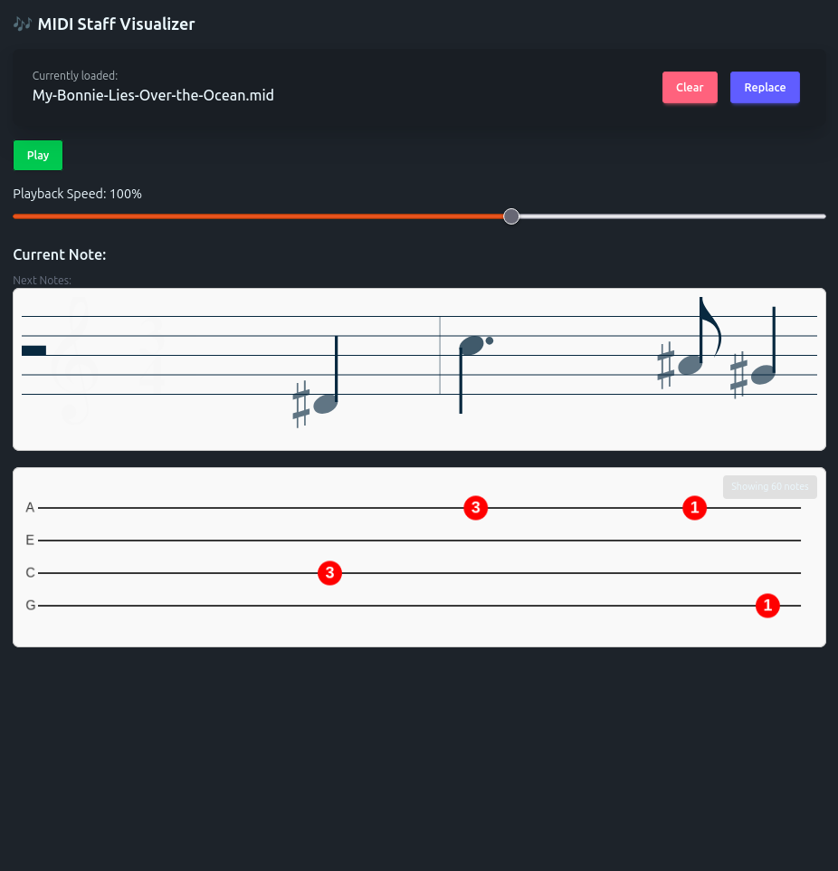

> [!NOTE]  
> *Archived Prototype. See also the adaption in [samlearns](https://github.com/koljapluemer/samlearns).*

# Uke and Flute

An experimental webapp for practicing instruments, mainly ukulele and flute.
Inspired by `yousician` and `SingStar`.

## Files, Folders, Functionality

### `MagentaStaffVisualizer`

### `UkeTabManagement`

An attempt to manage uke tabs as in-data
